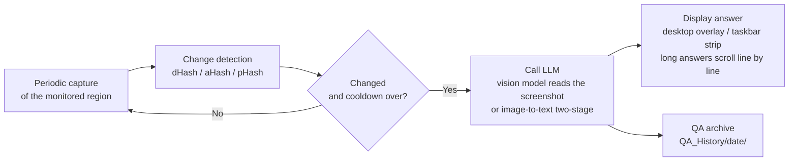
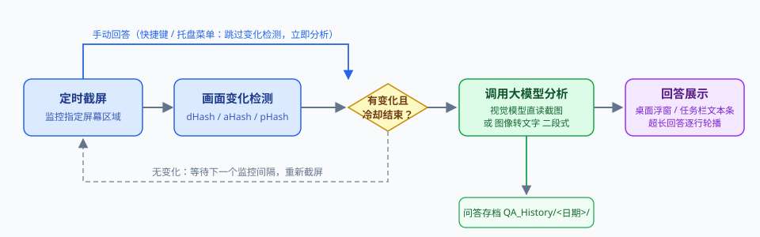
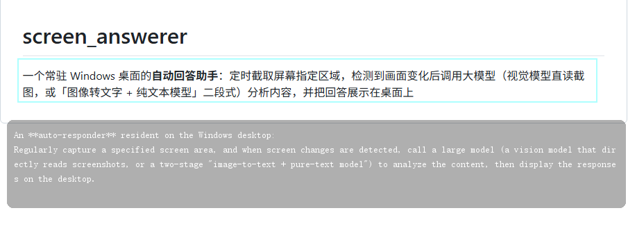
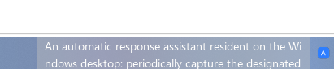
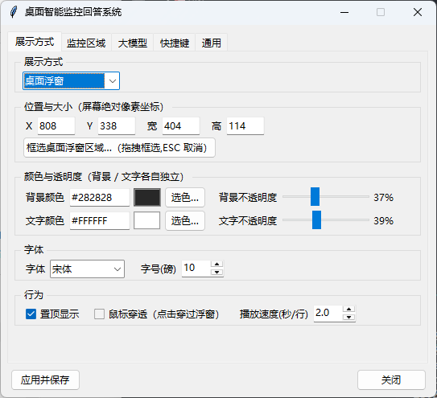
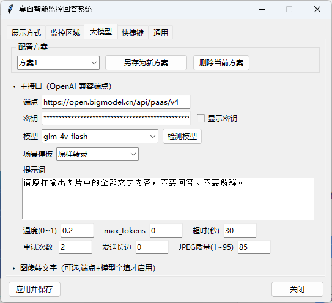

# Screen Answerer — Desktop Smart Monitor & Answer Assistant

[](#requirements)
[](#requirements)
[](LICENSE)

A **resident auto-answer assistant for Windows desktop**: it periodically captures a chosen screen region, detects visual changes, sends the content to an LLM (a vision model reading the screenshot directly, or a two-stage "image-to-text + text-only model" pipeline) and shows the answer on the desktop — either as a **semi-transparent desktop overlay** or as a **taskbar text strip** (embedded inside the system taskbar, same architecture as TrafficMonitor).

Every option can be adjusted in the tray "Settings" window and persists across restarts, so there is no need to edit config files by hand. The API key is stored locally only — nothing is uploaded to any third-party server (requests go solely to the LLM endpoint you configure).

## How It Works





## Use Cases

| Scenario | Description |
|----------|-------------|
| **Online quiz practice** | While working through questions on a quiz site or app, the tool recognizes the question on screen and gives an explanatory reference to help you understand the concept |
| **Online courses / recorded lectures** | While watching a lesson or slide deck, get automatic explanations of example problems and terminology shown on screen |
| **Homework / exam paper walkthrough** | Parents tutoring their children can box-select the paper region to get hints on how to solve a problem |
| **Screen content digest** | Change the prompt to "summarize / translate / extract key points" and the tool becomes an always-on "screen Q&A assistant" (e.g. translating foreign documents, summarizing long articles) |
| **Assisted reading / accessibility** | For users with impaired vision, render the content of a chosen screen region as large, displayable text |

> The prompt is fully configurable. At its core this is a generic **"periodic capture → change detection → LLM Q&A → desktop display"** framework, not limited to answering questions.

## Features

### Monitoring & Triggers

- **Only calls the model when the picture changes**: four comparison algorithms (dHash / aHash / pHash / pixel diff); no change means no tokens spent. Monitoring interval, change threshold and cooldown are configurable to prevent spam.
- **Region selection**: press a hotkey to drag-select the monitored region on a full-screen overlay; the selection is persisted automatically. An always-on green rectangle indicator is optional.
- **Manual answer**: press a hotkey at any time to capture the current region and analyze it immediately (change detection is skipped).
- **Pause / resume**: pause the periodic monitoring with one key; the next change check rebuilds its baseline from the current frame.

### Answer Display (two switchable modes)

- **Desktop overlay**: semi-transparent, always-on-top, with background and text color and opacity **independently adjustable** (per-pixel alpha via Win32 `UpdateLayeredWindow`); position, size, font and font size are all configurable.
  - Long answers are **never truncated — they scroll line by line** (speed = seconds per line, 0 = no scrolling); scrolling only applies in click-through mode.
  - With click-through disabled the overlay becomes fully interactive: **mouse wheel scrolls line by line**, **left-drag selects text** (inverted highlight, copy the selection), **Alt+drag moves** the window, **drag the bottom-right corner to resize**, **double-click / right-click copies the full answer** — position and size changes sync to settings in real time and persist.
- **Taskbar text strip**: a native window **embedded in the system taskbar** (left of the tray area, visually merged with the taskbar), or optionally floating-docked at bottom/top × left/center/right; 1–10 lines, wrapping by character count or pixel width, line-by-line scrolling, font / color / opacity all configurable.

### LLM

- **OpenAI-compatible endpoints**: works with most providers and local deployments (any `v1/chat/completions` API).
- **Multiple profiles**: save several "endpoint / key / model / prompt / parameters" profiles and switch between them instantly from a dropdown.
- **Prompt scenario templates**: 7 built-in presets (Answer question / Explain solution / Transcribe verbatim / Translate to Chinese / Summarize / Explain terminology / Compute formula) that fill the prompt box in one click.
- **Model discovery**: query the endpoint's available models (`GET /models`) and populate the model dropdown automatically.
- **Two-stage image-to-text (optional)**: configure a separate transcription model and screenshots are first converted to text before being handed to the main model — **the main model can be any text-only LLM**. The transcription result is injected into the main prompt at the dynamic variable `{{OCR_TEXT}}`.
- **Smart retries**: ordinary errors use exponential backoff (1s / 2s / 4s, capped at 8s); **429 rate limits are handled separately** — the server's `Retry-After` header is honored, otherwise a 5s → 10s → 20s long backoff (capped at 60s).
- **Call logging**: every call logs the endpoint, model, prompt and returned message for troubleshooting.

### Other

- **QA history**: the question screenshot and the answer of each analysis are saved as a pair under `QA_History/<date>/` using the same millisecond timestamp; kept by date and retained forever (can be disabled).
- **Global hotkeys**: all five function keys support "press-to-record" rebinding (keyboard combos or mouse buttons, e.g. `Ctrl+mouse side button`).
- **Tray resident**: no taskbar button; the tray menu exposes every common action.
- **UI language**: Chinese / English (Settings → General → Language, takes effect after restart). The language covers **all UI text, overlay/taskbar status hints (e.g. "[Monitoring paused]") and runtime logs**.
- **Config fault tolerance**: if `settings.json` is corrupted it is backed up as `.corrupt` and defaults are restored — the app never crashes because of it.

## Screenshots

> Placeholder paths below — drop your images into `docs/screenshots/` to display them.

| Desktop overlay | Taskbar strip |
|:---:|:---:|
|  |  |

| Display settings | LLM settings tab |
|:---:|:---:|
|  |  |

## Quick Start

### 1. Requirements

- Windows 10 / 11 (click-through, tray and taskbar embedding rely on Win32 features)
- Python 3.9+

### 2. Install dependencies

```bash
pip install -r requirements.txt
```

Six dependencies: `mss` (screen capture), `Pillow` (image processing), `requests` (HTTP), `keyboard` (global hotkeys), `mouse` (mouse hotkeys), `pystray` (tray). `tkinter` ships with Python.

### 3. Run

```bash
python main.py
```

The app then lives in the system tray (blue "A" icon). **Left-click the tray icon to show/hide the answer overlay**; right-click to open the menu with **all quick actions**:

- Show/hide desktop overlay
- Pause/resume periodic monitoring
- Answer now
- Select monitored region (full-screen drag selection)
- Show/hide region indicator
- Settings…
- Exit

Key labels in the menu follow your rebindings automatically.

### 4. First-time setup (three steps)

1. **Select the monitored region**: tray menu → Settings → "Monitoring" tab → click "Select region…" and drag-select the target area on the full-screen overlay;
2. **Configure the LLM**: on the "LLM" tab fill in the endpoint (e.g. `https://api.example.com/v1`), API key, model (you can click "Detect models" to fetch the list), and prompt (e.g. `Answer the question in the image; give only the correct option and a brief reason.`), then click "Apply & Save";
3. **See it work**: change something in the monitored region (e.g. flip to the next question) and the answer appears in the overlay.

## Usage Guide

### Overlay interactions (with click-through disabled)

| Action | Effect |
|------|------|
| Mouse wheel up/down | Scroll through long answers line by line |
| Left-drag | Select part of the answer (inverted highlight); copy with Ctrl+C or right-click → "Copy selection" |
| Alt + left-drag | Move the overlay (position persisted automatically) |
| Drag bottom-right corner | Resize the overlay (synced to settings in real time) |
| Double-click / right-click | Copy the full answer |

### Hotkeys (defaults; all rebindable in Settings)

| Hotkey | Function |
|--------|------|
| `Ctrl+Shift+F1` | Drag-select the monitored region on a full-screen overlay (ESC cancels) |
| `Ctrl+Shift+F2` | Capture and analyze the region once, immediately |
| `Ctrl+Shift+F3` | Pause / resume periodic monitoring |
| `Ctrl+Shift+F4` | Hide / show the answer (overlay or taskbar strip) |
| `Ctrl+Shift+F5` | Hide / show the monitored-region indicator |

### Settings window (tray right-click → Settings…, 5 tabs)

- **Display mode**: choose desktop overlay / taskbar strip; the options below switch accordingly. Hover any option for a detailed tooltip.
- **Monitoring**: region coordinates, interval, change threshold, cooldown, comparison algorithm, indicator style.
- **LLM**: multiple profile management (save as / delete / switch); two mutually exclusive collapsible sections "Main endpoint" and "Image-to-text"; **scenario templates** (one-click prompts for common use cases); endpoint / key / model / prompt / parameters (temperature, max_tokens, timeout, retries, downscale long edge, JPEG quality).
- **Hotkeys**: for each of the five functions, "Record" / "Clear" — press the desired combo to record it.
- **General**: UI language (Chinese / English, applied after restart), startup behavior (start paused / hide overlay), log level, QA history toggle and folder, and an "About" block (version and GitHub project page; click the link to open the repo).

The bottom "**Apply & Save**" button applies changes to the running app and writes them back to `settings.json`; no dialog on success.

## LLM Configuration Details

### Prompt

The prompt is sent to the **main model** and is a multi-line editor. The "**Scenario templates**" dropdown offers 7 built-in presets that fill the prompt box in one click (editable afterwards):

| Template | Prompt content |
|----------|----------------|
| Answer question | Recognize and answer the question in the image; give the correct answer (option or value) directly, with a one-sentence reason |
| Explain solution | Give the correct answer and explain the solution step by step, including the concepts involved |
| Transcribe verbatim | Output all text in the image verbatim — do not answer, do not explain |
| Translate to Chinese | Translate the text in the image into Chinese, preserving headings, lists and table structure |
| Summarize | Extract the key points of the image and summarize them as a concise bulleted list |
| Explain terminology | Identify the terms, concepts or proper nouns in the image and explain each one in plain language |
| Compute formula | Recognize the formula or expression in the image and show the working and final result |

When "Image-to-text" is configured, the transcription result can be embedded in two ways:

> **The main prompt may be empty**: when empty, no instruction is prepended — without image-to-text only the screenshot is sent (requires a vision model); with it configured, only the transcribed text is sent. The default image-to-text prompt is "Output all text in the image verbatim — do not answer, do not explain."

1. **Dynamic variable** (recommended): put `{{OCR_TEXT}}` anywhere in the prompt and it is replaced with the transcription at runtime (case-insensitive, tolerating the typo `{{ORC_TEXT}}`):

   ```
   Question content:
   {{OCR_TEXT}}

   Give the correct option directly, with a one-sentence reason.
   ```

2. **Automatic append**: if the variable is absent, the transcription is appended at the end under a "【Image transcription】" section.

### Image-to-text (two-stage, optional)

When not configured, the screenshot is sent straight to the main model (**which must support vision/image input**). When configured (enabled only if endpoint + model are both filled):

```
Screenshot ──► transcription model (e.g. a small vision model) ──► text ──► embedded in prompt ──► main model (may be text-only) ──► answer
```

This suits cases where the main model has no vision capability (e.g. a text-only chat model), or lets you use a cheap small vision model for transcription and an expensive model for reasoning to save money.

### Hitting 429 rate limits?

Free / low-tier accounts have tight concurrency and RPM limits, and the two-stage pipeline sends two requests to the same endpoint per round. The app already implements backoff (honoring `Retry-After`, or 5s → 60s long backoff); it also helps to increase the monitoring interval (≥10 seconds) and to split transcription and main-model traffic across different providers.

## Configuration File (settings.json, generated next to the program)

Normally no manual editing is needed — everything can be adjusted and persisted in the Settings window:

| Group | Contents |
|--------|---------|
| `capture` | Monitoring interval, monitored region `[left, top, width, height]`, comparison algorithm and threshold, cooldown |
| `llm` | `active` (current profile name) + `profiles` (multiple profiles: endpoint / key / model / prompt / temperature / max_tokens / timeout / retries / long-edge downscale / JPEG quality; optional `ocr_*` image-to-text fields) |
| `overlay` | Display mode (`overlay` / `taskbar`), overlay position / size / colors / opacity / font / click-through / scroll speed |
| `taskbar` | Taskbar strip: position layout, number of lines, characters per line, scroll speed, font / colors / opacity |
| `region_rect` | Region indicator visibility at startup, color, opacity |
| `startup` | Whether to start paused, whether to hide the overlay |
| `general` | UI language (`zh` Chinese / `en` English) |
| `hotkeys` | The five hotkey bindings (mouse buttons supported, e.g. `ctrl+mouse_x2`) |
| `storage` | QA history folder (default `QA_History`), recording toggle |
| `log` | Log level, log file name |

> ⚠️ **`settings.json` contains your API key — never commit it** (excluded by `.gitignore` by default).

## Packaging as a Single-File EXE (optional)

```bash
# 1. Create a clean build environment (avoid pulling in unrelated dependencies)
python -m venv .build_venv
.build_venv\Scripts\pip install mss Pillow requests keyboard pystray pyinstaller

# 2. Build (output: dist\screen_answerer.exe, ~20 MB single file)
.build_venv\Scripts\python.exe -m PyInstaller main.spec --noconfirm --clean
```

Packaging details are baked into `main.spec` / `build_exe.bat`. In frozen mode `settings.json`, `app.log` and `QA_History/` are created next to the exe, so you can distribute the exe as-is. UPX is not used (to avoid antivirus false positives).

## Project Structure

```
answer/
├── main.py              # Entry point (thin): module re-exports + main()
├── core/                # Business core
│   ├── appconfig.py     #   Config load/save, logging setup
│   ├── monitor.py       #   Region capture, dHash change detection, background monitor thread
│   ├── llmclient.py     #   LLM calls (OpenAI-compatible, retries and rate-limit backoff, call logging)
│   ├── imagerender.py   #   Overlay image rendering, pixel wrapping, selection hit-testing
│   ├── artifacts.py     #   QA history saved as pairs, grouped by date
│   └── controller.py    #   Queue dispatch, hotkey management
├── ui/                  # Presentation layer
│   ├── overlaywin.py    #   Desktop overlay (per-pixel transparent layered window)
│   ├── taskbarwin.py    #   Taskbar text strip (child window embedded in the taskbar)
│   ├── rectindicator.py #   Monitored-region indicator
│   ├── regionselector.py#   Full-screen drag region selector
│   ├── settingsui.py    #   Settings dialog (5 tabs)
│   └── trayicon.py      #   Tray icon and menu
├── win32/               # Windows platform layer
│   ├── win32util.py     #   Layered window styles, UpdateLayeredWindow, taskbar queries
│   └── hotkey_capture.py#   Keyboard combo / mouse button recording
├── tests/test_main.py   # Tests (19 items: python tests/test_main.py)
├── assets/              # Packaging resources (icon, version info)
├── docs/                # Documentation images (architecture / workflow / screenshots)
├── main.spec            # PyInstaller build config
├── build_exe.bat        # One-click build script
└── requirements.txt     # Dependency list
```

Runtime artifacts (generated automatically, not committed): `settings.json`, `app.log`, `QA_History/`.

## FAQ

<details>
<summary><b>I get 402 Payment Required</b></summary>
Your LLM provider account has run out of balance / free quota. Top up or switch endpoints — the app itself is fine.
</details>

<details>
<summary><b>Hotkeys don't work</b></summary>
The <code>keyboard</code> library may need administrator privileges to register global hotkeys in some environments; try running as administrator. Combos can also be grabbed by other programs — rebind them in the Settings window.
</details>

<details>
<summary><b>The overlay doesn't show in full-screen games</b></summary>
Layered windows may not display above exclusive full-screen mode; this is a system limitation. Windowed / borderless full-screen usually works.
</details>

<details>
<summary><b>False or missed triggers</b></summary>
Adjust the change threshold on the "Monitoring" tab (8–15 is a good starting point for text-only questions), plus the monitoring interval and cooldown.
</details>

<details>
<summary><b>The model's answers don't match expectations</b></summary>
Check the prompt; enable "Record analysis screenshots and answers" and inspect the actual screenshot and full answer under <code>QA_History/&lt;date&gt;/</code>. The log also prints the endpoint, model, prompt and returned message of every call.
</details>

<details>
<summary><b>How do I run the tests</b></summary>
<code>python tests/test_main.py</code> — 20 items covering config parsing, i18n, change detection, LLM request construction (mocked network), 429 backoff, the image-to-text two-stage pipeline, overlay scrolling/dragging/resizing/selection-copy, the settings window, startup smoke tests, etc.
</details>

## Privacy & Security

- Screenshots are sent **only to the LLM endpoint you configure**; the app bundles and forwards to no third-party service;
- The API key is stored only in the local `settings.json`, which is listed in `.gitignore` — never commit or share it;
- QA history (screenshot + answer) is stored locally under `QA_History/`; you can disable recording in Settings or clean it up manually.

## Disclaimer

This project is intended for **personal learning and lawful use only**. Please comply with the rules of your platform / school / institution and do not use it in any way that violates exam regulations, terms of service or applicable law. You are solely responsible for any consequences of using this project.

## License

This project is released under the [MIT License](LICENSE).

Copyright (c) 2026 LK311
