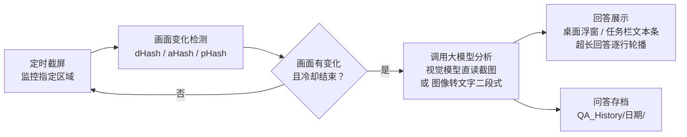
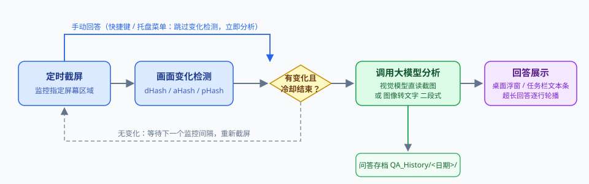
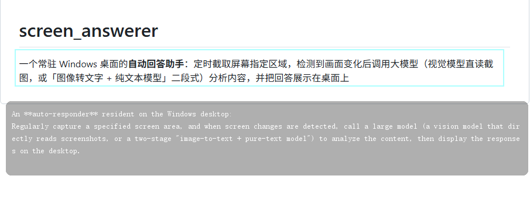
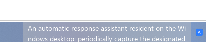
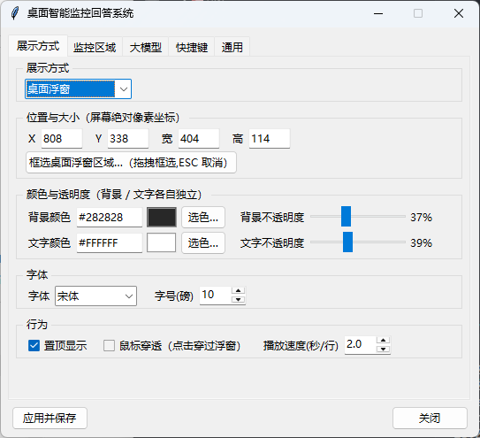
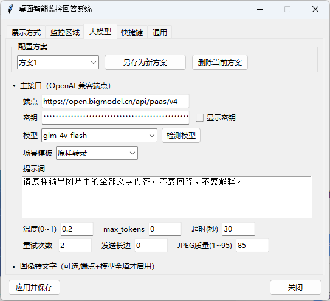

# 桌面智能监控回答系统（Screen Answerer）

[](#环境要求)
[](#环境要求)
[](LICENSE)

一个常驻 Windows 桌面的**自动回答助手**：定时截取屏幕指定区域，检测到画面变化后调用大模型（视觉模型直读截图，或「图像转文字 + 纯文本模型」二段式）分析内容，并把回答展示在桌面上——可选**半透明桌面浮窗**或**任务栏文本条**（嵌入系统任务栏内，TrafficMonitor 同款架构）两种形式。

所有配置均可在托盘「设置」窗口中调整并持久生效，无需手改配置文件；API Key 仅保存在本机，不上传任何第三方服务器（仅发往您自己配置的大模型端点）。

## 工作原理





## 应用场景

| 场景 | 说明 |
|------|------|
| **在线刷题练习** | 在刷题网站/题库软件上做题时，自动识别屏幕上的题目并给出解析参考，辅助理解知识点 |
| **网课 / 录播学习** | 观看教学视频或课件时，对画面中的例题、术语自动给出讲解补充 |
| **试卷 / 作业讲解** | 家长辅导孩子时，框选试卷区域即可获得解题思路参考 |
| **屏幕内容速览** | 将提示词改为"总结/翻译/提取要点"，把工具变成一个常驻桌面的"屏幕问答助手"（如翻译外文文档、总结长文） |
| **辅助阅读 / 无障碍** | 对视力不便的用户，将屏幕指定区域的内容转成可缩放的大字文本展示 |

> 提示词完全可配置，本质上这是一个「**定时截屏 → 变化检测 → 大模型问答 → 桌面展示**」的通用框架，不限于答题。

## 功能特性

### 监控与触发

- **变化检测才调用模型**：dHash / aHash / pHash / 像素比较四种算法可选，画面无变化不消耗 token；可配置监控间隔、变化阈值与冷却时间，防止刷屏。
- **区域框选**：快捷键全屏拖拽框选监控区域，自动持久化；可选常显绿色矩形指示框。
- **手动回答**：随时按快捷键对当前区域立即截屏分析（跳过变化检测）。
- **暂停 / 恢复**：一键暂停定时监控，下次变化检测从当前画面重新建立基线。

### 回答展示（两种方式可切换）

- **桌面浮窗**：半透明、置顶，背景与文字的颜色、不透明度**各自独立可调**（Win32 `UpdateLayeredWindow` 逐像素 alpha）；位置/尺寸/字体/字号均可配置。
  - 超长回答**不截断，按行自动轮播**（播放速度 = 秒/行，0 = 不轮播）；轮播仅在鼠标穿透模式下生效。
  - 取消穿透后支持丰富交互：**滚轮逐行滚动**、**左键拖选文本**（反色高亮，复制所选片段）、**Alt+拖动移动**、**右下角拖拽缩放**、**双击/右键复制全文**——位置与尺寸改动实时同步到设置并持久化。
- **任务栏文本条**：原生窗口直接**嵌入系统任务栏**（托盘区左侧，与任务栏融为一体），也可选底/顶 × 左/中/右浮动停靠；显示行数 1~10、按字符数或像素宽度折行、逐行轮播，字体/颜色/透明度全可配。

### 大模型

- **OpenAI 兼容端点**：兼容绝大多数服务商与本地部署（如各类 `v1/chat/completions` 接口）。
- **多配置方案**：可保存多组「端点/密钥/模型/提示词/参数」方案，下拉切换立即生效。
- **提示词场景模板**：内置 7 个常见应用场景预设（题目解答 / 题目解析 / 原样转录 / 翻译成中文 / 内容总结 / 术语讲解 / 公式计算），一键填入。
- **检测模型**：一键向端点查询可用模型列表（`GET /models`）自动填充下拉框。
- **图像转文字二段式**（可选）：配置独立的转写模型后，截图先转成文字再交给主模型——**主模型可以是任意纯文本大语言模型**；转写结果通过动态变量 `{{OCR_TEXT}}` 嵌入主提示词的任意位置。
- **智能重试**：普通错误指数退避（1s/2s/4s，上限 8s）；**429 限流单独处理**——遵循服务端 `Retry-After` 头，否则 5s→10s→20s 长退避（上限 60s）。
- **调用日志**：每次调用在日志中输出调用地址、模型名、提示词与返回消息，便于排查。

### 其他

- **问答历史**：每次分析的问题截图与回答按同毫秒时间戳成对保存到 `QA_History/<日期>/`，按日期存放、历史永久保留（可关闭）。
- **全局快捷键**：五个功能键位均支持「按下即录入」改键（键盘组合键或鼠标按键，如 `Ctrl+鼠标侧键`）。
- **托盘常驻**：不占任务栏，托盘菜单提供全部常用入口。
- **界面语言**：中文 / English 可切换（设置 → 通用 → 语言，保存后重启程序生效）。语言同时覆盖**全部界面文案、浮窗/任务栏状态提示（如"[定时监控已暂停]"）与运行日志**。
- **配置容错**：`settings.json` 损坏时自动备份为 `.corrupt` 并回退默认值，程序不会崩溃。

## 界面预览

> 以下截图路径已预留，放入 `docs/screenshots/` 即可显示。

| 桌面浮窗 | 任务栏文本条 |
|:---:|:---:|
|  |  |

| 展示设置 | 大模型设置页 |
|:---:|:---:|
|  |  |

## 快速开始

### 1. 环境要求

- Windows 10 / 11（鼠标穿透、托盘、任务栏嵌入依赖 Win32 特性）
- Python 3.9+

### 2. 安装依赖

```bash
pip install -r requirements.txt
```

依赖共 6 个：`mss`（截屏）、`Pillow`（图像处理）、`requests`（HTTP）、`keyboard`（全局热键）、`mouse`（鼠标热键）、`pystray`（托盘）。`tkinter` 为 Python 标准库自带。

### 3. 运行

```bash
python main.py
```

启动后程序常驻系统托盘（蓝底 "A" 图标）。**左键单击托盘图标 = 显示/隐藏回答浮窗**；右键托盘图标打开菜单，**包含全部快捷操作**：

- 显示/隐藏桌面浮窗
- 暂停/恢复定时监控
- 手动回答
- 框选监控区域（全屏拖拽框选）
- 显示/隐藏区域指示框
- 设置…
- 退出

菜单项的键位标签随设置中的改键自动跟随。

### 4. 首次配置（三步）

1. **框选监控区域**：托盘菜单 → 设置 → 「监控区域」页 → 点「框选监控区域…」，全屏拖拽框选目标区域；
2. **配置大模型**：「大模型」页填入端点（如 `https://api.example.com/v1`）、API Key、模型名（可点「检测模型」自动拉取列表）、提示词（如 `请回答图中的题目，只给出正确选项和简要理由。`），点「应用并保存」；
3. **观察效果**：对监控区域做出画面变化（如翻到下一题），浮窗会自动出现回答。

## 操作指南

### 浮窗交互（取消「鼠标穿透」后）

| 操作 | 效果 |
|------|------|
| 滚轮上下滚动 | 逐行翻看超长回答 |
| 左键拖选 | 选中回答片段（反色高亮），Ctrl+C 或右键「复制所选」复制 |
| Alt + 左键拖动 | 移动浮窗位置（自动持久化） |
| 右下角拖拽 | 调整浮窗尺寸（实时同步设置） |
| 双击 / 右键 | 复制回答全文 |

### 快捷键（默认键位，均可在设置中改键）

| 快捷键 | 功能 |
|--------|------|
| `Ctrl+Shift+F1` | 全屏拖拽框选监控区域（ESC 取消） |
| `Ctrl+Shift+F2` | 手动触发一次区域截屏与回答 |
| `Ctrl+Shift+F3` | 暂停 / 恢复定时监控 |
| `Ctrl+Shift+F4` | 隐藏 / 显示回答（浮窗或任务栏文本条） |
| `Ctrl+Shift+F5` | 隐藏 / 显示监控区域指示框 |

### 设置窗口（托盘右键 → 设置…，共 5 个标签页）

- **展示方式**：桌面浮窗 / 任务栏文本条二选一，下方设置项随选择联动；悬停任一设置项会显示详细说明。
- **监控区域**：区域坐标、监控间隔、变化阈值、冷却时间、比较算法、指示框样式。
- **大模型**：多配置方案管理（另存/删除/切换）；「主接口」与「图像转文字」两个互斥折叠区域；**场景模板**（常见应用场景提示词一键填入）；端点/密钥/模型/提示词/参数（温度、max_tokens、超时、重试、发送长边缩放、JPEG 质量）。
- **快捷键**：五个功能「录入 / 清除」，按下目标组合键即自动录入。
- **通用**：界面语言（中文 / English，保存后重启生效）、启动行为（启动时暂停/隐藏浮窗）、日志级别、问答历史开关与目录、「关于」块（版本号与 GitHub 项目主页，点击链接打开仓库）。

底部「**应用并保存**」一键完成：运行时实时生效并写回 `settings.json`，成功无弹窗。

## 大模型配置详解

### 提示词

提示词发送给**主模型**，多行编辑。设置页提供「**场景模板**」下拉，内置 7 个常见应用场景预设，选择后一键填入提示词框（可再手工修改）：

| 场景模板 | 提示词内容 |
|----------|-----------|
| 题目解答 | 识别并回答图片中的题目，直接给出正确答案（选项或数值），并用一句话说明理由 |
| 题目解析 | 给出正确答案，并分步骤讲解解题过程与涉及的知识点 |
| 原样转录 | 原样输出图片中的全部文字内容，不要回答、不要解释 |
| 翻译成中文 | 把图片中的文字翻译成中文，保持原有的标题、列表、表格结构 |
| 内容总结 | 提取图片内容的要点，用简洁的条目式列表总结 |
| 术语讲解 | 识别图片中的术语、概念或专有名词，逐条给出通俗易懂的解释 |
| 公式计算 | 识别图片中的公式或算式，给出计算过程与最终结果 |

配置了「图像转文字」时，转写结果有两种嵌入方式：

> **主提示词可留空**：留空时不附加任何指令——未配置图像转文字时仅发送截图（需视觉模型），配置后仅发送转写内容。图像转文字提示词默认值为「请原样输出图片中的全部文字内容，不要回答、不要解释。」

1. **动态变量**（推荐）：在提示词任意位置写 `{{OCR_TEXT}}`，运行时替换为转写结果（不区分大小写，容错手误 `{{ORC_TEXT}}`）：

   ```
   题目内容如下：
   {{OCR_TEXT}}

   请直接给出正确选项，并用一句话说明理由。
   ```

2. **自动追加**：提示词中未出现该变量时，转写结果以「【图片内容转写】」小节追加到末尾。

### 图像转文字（二段式，可选）

不配置时，截图直接发给主模型（**主模型必须支持视觉/图像输入**）。配置后（端点 + 模型全填才启用）：

```
截图 ──► 转写模型（如视觉小模型）──► 文字 ──► 嵌入提示词 ──► 主模型（可为纯文本模型）──► 回答
```

适合主模型不含视觉能力的场景（如纯文本对话模型），或用便宜的视觉小模型做转写、贵模型做推理以省钱。

### 遇到 429 限流？

免费/低档账户的并发与 RPM 限制较低，且二段式每轮会对同一端点连发 2 次请求。程序已内置限流退避（遵循 `Retry-After` 或 5s→60s 长退避），另建议：拉大监控间隔（≥10 秒）；转写与主模型使用不同服务商分摊配额。

## 配置文件说明（settings.json，程序同目录自动生成）

通常无需手改，所有配置都能在设置窗口调整并持久化：

| 配置组 | 内容 |
|--------|------|
| `capture` | 监控间隔、监控区域 `[left, top, width, height]`、比较算法与阈值、冷却时间 |
| `llm` | `active`（当前方案名）+ `profiles`（多组方案：端点/密钥/模型/提示词/温度/max_tokens/超时/重试/发送长边/JPEG 质量；可选图像转文字四项 `ocr_*`） |
| `overlay` | 展示方式（`overlay`/`taskbar`）、浮窗位置/尺寸/颜色/透明度/字体/穿透/轮播速度 |
| `taskbar` | 任务栏文本条：位置布局、显示行数、每行字符数、轮播速度、字体/颜色/透明度 |
| `region_rect` | 区域指示框启动显隐、颜色、透明度 |
| `startup` | 启动时是否暂停监控、隐藏浮窗 |
| `general` | 界面语言（`zh` 中文 / `en` English） |
| `hotkeys` | 五个快捷键键位（支持鼠标按键，如 `ctrl+mouse_x2`） |
| `storage` | 问答历史目录（默认 `QA_History`）、记录开关 |
| `log` | 日志级别、日志文件名 |

> ⚠️ **`settings.json` 中包含您的 API Key，请勿提交到版本库**（本项目 `.gitignore` 已默认排除）。

## 打包为单文件 exe（可选）

```bash
# 1. 创建干净的构建环境（避免混入无关依赖）
python -m venv .build_venv
.build_venv\Scripts\pip install mss Pillow requests keyboard pystray pyinstaller

# 2. 构建（产物：dist\screen_answerer.exe，约 20MB 单文件）
.build_venv\Scripts\python.exe -m PyInstaller main.spec --noconfirm --clean
```

打包细节固化在 `main.spec` / `build_exe.bat` 中。frozen 模式下 `settings.json`、`app.log`、`QA_History/` 均生成在 exe 所在目录，直接拷贝 exe 即可分发。未使用 UPX（规避杀软误报）。

## 项目结构

```
answer/
├── main.py              # 程序入口（薄）：模块再导出 + main()
├── core/                # 业务核心
│   ├── appconfig.py     #   配置加载/保存、日志初始化
│   ├── monitor.py       #   区域截屏、dHash 变化检测、后台监控线程
│   ├── llmclient.py     #   大模型调用（OpenAI 兼容、重试与限流退避、调用日志）
│   ├── imagerender.py   #   浮窗图像渲染、像素折行、选区命中
│   ├── artifacts.py     #   问答历史按日期成对保存
│   └── controller.py    #   队列分发、热键管理
├── ui/                  # 展示层
│   ├── overlaywin.py    #   桌面浮窗（逐像素透明分层窗口）
│   ├── taskbarwin.py    #   任务栏文本条（嵌入任务栏子窗口）
│   ├── rectindicator.py #   监控区域指示框
│   ├── regionselector.py#   全屏拖拽区域选择浮层
│   ├── settingsui.py    #   设置对话框（5 标签页）
│   └── trayicon.py      #   托盘图标与菜单
├── win32/               # Windows 平台层
│   ├── win32util.py     #   分层窗口样式、UpdateLayeredWindow、任务栏查询
│   └── hotkey_capture.py#   组合键/鼠标按键录入
├── tests/test_main.py   # 测试（19 项：python tests/test_main.py）
├── assets/              # 打包资源（图标、版本信息）
├── docs/                # 文档图片（架构图/流程图/截图）
├── main.spec            # PyInstaller 打包配置
├── build_exe.bat        # 一键打包脚本
└── requirements.txt     # 依赖清单
```

运行时产物（自动生成，不入库）：`settings.json`、`app.log`、`QA_History/`。

## 常见问题（FAQ）

<details>
<summary><b>报 402 Payment Required</b></summary>
大模型服务商账户余额/免费额度不足，充值或更换端点即可，程序本身无问题。
</details>

<details>
<summary><b>快捷键无效</b></summary>
<code>keyboard</code> 库在某些环境注册全局热键需要管理员权限，以管理员身份运行试试；组合键可能被其他程序抢占，到设置窗口换键位即可。
</details>

<details>
<summary><b>全屏游戏中浮窗不显示</b></summary>
分层窗口在全屏独占模式之上可能无法显示，属系统限制；窗口化/无边框全屏一般正常。
</details>

<details>
<summary><b>误触发 / 漏触发</b></summary>
调整「监控区域」页的变化阈值（纯文字题建议 8~15）、监控间隔与冷却时间。
</details>

<details>
<summary><b>模型返回内容与预期不符</b></summary>
检查提示词；开启「记录分析截图与回答」后到 <code>QA_History/&lt;日期&gt;/</code> 查看实际发送的截图与完整回答；日志中会输出每次调用的地址、模型、提示词与返回消息。
</details>

<details>
<summary><b>如何运行测试</b></summary>
<code>python tests/test_main.py</code>，共 20 项：配置解析、多语言（i18n）、变化检测、LLM 请求构造（mock 网络）、429 限流退避、图像转文字二段式、浮窗轮播/拖动/缩放/拖选复制、设置窗口、启动冒烟等。
</details>

## 隐私与安全

- 截图**仅发送给您自己配置的大模型端点**，程序不内置、不转发任何第三方服务；
- API Key 仅保存在本机 `settings.json`，已加入 `.gitignore`，请勿提交或分享；
- 问答历史（截图 + 回答）保存在本地 `QA_History/` 目录，可在设置中关闭记录或定期手动清理。

## 免责声明

本项目仅供**个人学习与合法用途**使用。请遵守您所在平台/学校/机构的相关规则，不得用于任何违反考试纪律、服务条款或法律法规的场景。使用本项目产生的一切后果由使用者自行承担。

## 许可证

本项目采用 [MIT 许可证](LICENSE) 开源。

Copyright (c) 2026 LK311
